# Hero map: versions and how they work

This document describes every variant of the step-based hero map. Each version lives on its own branch, so they can be compared side by side and merged selectively.

| Branch | What it adds | Built on | New data | Extra runtime cost |
| --- | --- | --- | --- | --- |
| `feature/hero-scroll-nodes` | Step-based journey, quick direct camera moves | `main` | none | baseline |
| `feature/hero-scroll-nodes-zoom` | Same, but zooms out between stops, travels, then zooms in | `main` | none | baseline |
| `feature/map-v1-vehicles` | Low-poly 3D car and ferry drive the route; ambient ships and cars | quick-move branch | none | ~40 small meshes, 3 render passes |
| `feature/map-v2-detail` | Real land cover, 3D forests and towns, landmarks, road network | quick-move branch | `landcover.webp` 386 KB, `detail.json` 616 KB (189 KB gzipped) | ~24k instances (~0.8M triangles) near stops |
| `feature/map-v3-ride-along` | Chase camera that rides behind the car or ferry between stops | V1 | none | same as V1 |
| `feature/map-v4-daylight` | A day passes along the route: dawn → noon → golden hour → night | quick-move branch | `landcover.webp` (for city lights) | heavier terrain shader (shadow ray-march) |

To try a branch:

```bash
git fetch origin
git checkout feature/map-v1-vehicles
npm install
npm run dev
```

Stepping works the same on every branch: one wheel notch, swipe or arrow key moves one step (intro → six stops → route overview), and scrolling back up steps back.

---

## Shared fix: route bar at the top, aligned underlines

Applied to both `feature/hero-scroll-nodes` and `feature/hero-scroll-nodes-zoom`, and inherited by all versions.

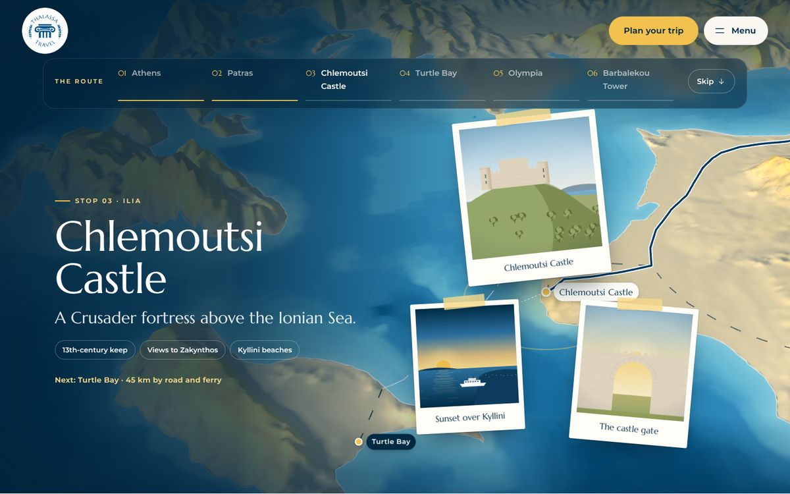

- **Position.** "The route" bar moved from the bottom of the hero to the top, directly under the fixed header (`--bar-top`: 112 px desktop, 108 px tablet, 96 px phone). On desktop it sits on a frosted panel (`backdrop-filter: blur`) so it stays readable over bright mountains. The panel text, scroll cue and scrim gradients were rebalanced for the new layout.
- **Underline alignment.** Names such as "Chlemoutsi Castle" wrap to two lines, which pushed their underline lower than single-line names. Each list item is now a grid that stretches to the row height, and the button has `grid-template-rows: 1fr auto`, so every underline sits on the same bottom line regardless of wrapping.
- **Overlay safe area.** `overlay.ts` used to reserve space above the bar for pins, polaroids and the traveller label. It now starts the safe area below the bar and runs to the bottom edge. Pins and the traveller label hide while they're behind the bar.
- **Phone.** On phones the bar is a horizontally scrolling row of pills. The active stop now scrolls into the middle of that row, because at the top it was easy to miss when it sat off-screen.

Assumption: "displayed at the top" was read as the bar's position on screen, not its stacking order. The bar was already painted above the map layers.

---

## Version 1: 3D cars and ferries (`feature/map-v1-vehicles`)

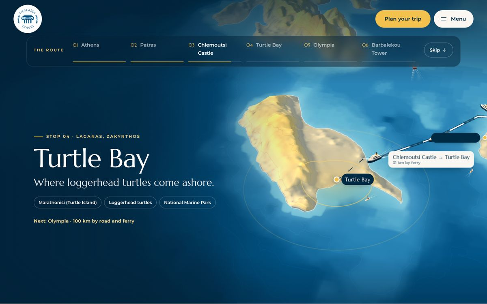
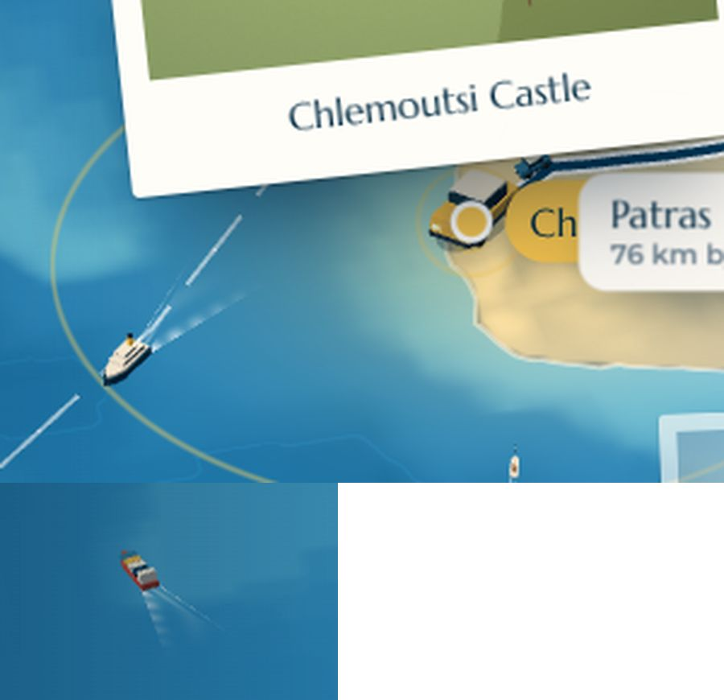

**What you see.** The traveller icon is replaced by a small 3D car on road legs and a ferry with a foaming wake on the sea leg. Sailboats, ferries and a container ship move along real sea lanes (Piraeus–Aegina, Patras–Italy, Kyllini–Zakynthos and Kyllini–Kefalonia, plus the Saronic and Corinth gulfs). Small cars drive both ways along the route's roads.

**How it works** (`src/scripts/map/vehicles.ts`)
- **Models.** All models are built from three.js primitives with flat-shaded `MeshStandardMaterial`, so there are no model files to download. The hulls are extruded 2D outlines with a pointed bow. The wake is a trapezoid with a small shader of animated ripples that fade with distance and speed.
- **Size.** The hero vehicle keeps a constant size on screen (`scale = camera distance × 0.034`), so it reads as a marker at every zoom level. Ambient traffic has a fixed world size (about 1.2–2.7 km, toy scale), so it only shows up when zoomed in and doesn't clutter the overview.
- **Heading.** Heading comes from the pre-smoothed route path, with a ±1.5 km window, and is low-pass filtered so the car doesn't jitter on tight bends. When the route is drawn backwards (stepping up), the car turns around. Switching between road and sea plays a short scale "pop".
- **Render passes.**
  1. Terrain and route lines.
  2. Ships, depth-tested against the terrain so islands hide them.
  3. Depth is cleared, then the hero vehicle and road cars are drawn on top.

  Road cars go in the last pass because the route path follows a finer height sample than the 2 km terrain mesh, so depth-tested cars would sink into slopes.
- **Behaviour changes.**
  - Drives last longer (2–4.5 s, previously 1.2–3 s) so you can actually follow the vehicle.
  - Polaroids now wait until the vehicle has arrived, not just the camera.
  - With reduced motion turned on, traffic freezes.

**Trade-offs.** The sea lanes are hand-placed coordinates. The vehicles don't cast real shadows, only a soft blob under the car. The constant-size hero vehicle is deliberately larger than true scale.

---

## Version 2: real-world detail (`feature/map-v2-detail`)

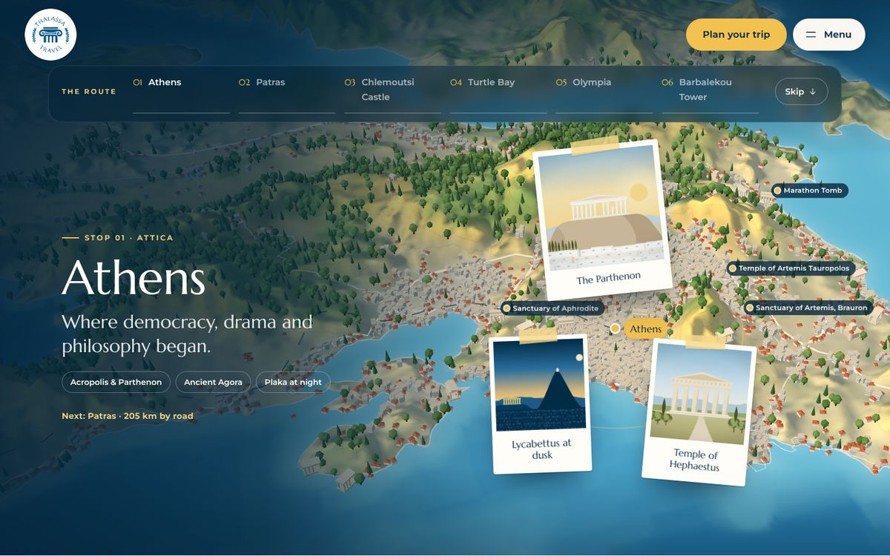
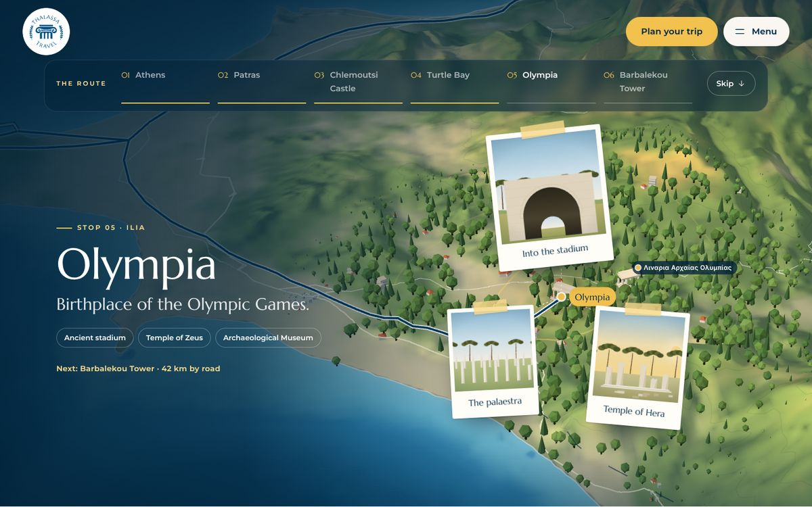
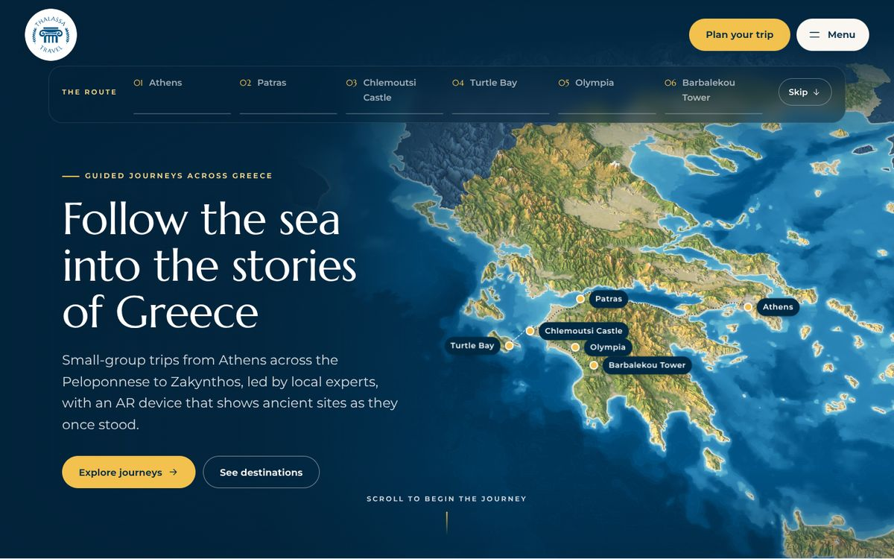

**What you see.**
- The terrain is tinted by real land cover: forest green, cropland gold, scrub, and pale built-up areas.
- Near the route, about 18,000 low-poly trees (round trees and cypresses) stand where the forests really are.
- About 5,900 houses and white apartment blocks sit where the built-up areas are. Athens becomes a dense white carpet with terracotta roofs.
- Castles, lighthouses and ancient sites from Overture Maps appear as small 3D glyphs.
- Motorways and primary roads are drawn as fine cream lines.
- At each stop, up to four nearby landmarks get labels that avoid the pins, polaroids and text.
- The detail grows outward in a wave from the first stop you reach.

**Data pipeline** (`scripts/build-detail-data.py`, `npm run data:detail`)

| Source | Read with | Used for |
| --- | --- | --- |
| ESA WorldCover 10 m (2021) | `rasterio`, streaming the 1/16 overviews (160 m) of 12 Cloud-Optimised GeoTIFF tiles straight from S3, about 1 s per tile | the `landcover.webp` texture, plus tree and house positions |
| Overture Maps (2026-10-21 release) | `pyarrow`, with bbox filters pushed down to the GeoParquet row groups (189k places in about 3 s, 45k road segments in about 10 s) | landmarks and the road network |

- **Why these sources.** Overpass, the OSM tile servers and Geofabrik were blocked in the build environment, while both of these sources are public S3 buckets that need no API key. They are also versioned releases, which makes the builds reproducible.
- **Land-cover texture.** `landcover.webp` stores class fractions on the same pixel grid as the heightmap, at half resolution: R = tree cover, G = built-up, B = cropland, A = shrub + grass.
- **Trees and houses.** These are jittered grid samples (0.62 km for trees, 0.4 km for houses) kept with a probability that follows the local tree or built-up fraction. Positions are quantised to 1/2000° and stored in `detail.json`.
- **Landmarks.** Overture places are noisy: apartments and banks get tagged as "historic". Places are kept only if their name matches castle, temple, theatre, stadium, tomb or lighthouse keywords in Greek or English, after a junk filter, de-duplication within 2.5 km, and a small rename table that gives the main sites English names. Others keep their Greek names, which reads as local flavour.

**Rendering** (`detail.ts`, `poi.ts`, `terrainMaterial.ts`)
- **Land-cover tint.** The terrain shader mixes the land-cover colours into the land colour before hillshading, only inside Greece and not on snowy peaks. The tint fades in once the texture has loaded.
- **Ground placement.** Trees and houses are `InstancedMesh`es with vertex colours, plus per-instance colours for the greens. Their ground height copies the terrain mesh's own interpolation (heights at the 560-segment grid vertices, interpolated between them), so objects sit on the visible surface instead of the finer heightmap.
- **Reveal wave and distance fade.** A patched vertex shader (`onBeforeCompile`) scales each instance by a reveal wave (70 km/s from the first stop reached) and by camera distance, so all the detail disappears in the overview.
- **Camera and polaroids.** The camera sits 38% closer at stops, and the polaroids are 22% smaller so they don't hide the detail.
- **Loading.** `detail.json` and the texture load after the map is already interactive, so the first paint isn't slower.

**Trade-offs.**
- About 0.8M extra triangles near the stops: fine on desktop, but the first thing to cut on low-end phones (a smaller instance cap, or the tint only).
- Some labels are in Greek.
- **Attribution is needed before shipping:** "ESA WorldCover © ESA 2021 (CC BY 4.0)" and "© OpenStreetMap contributors, Overture Maps Foundation" (the roads are ODbL; places are CDLA-Permissive-2.0).

---

## Version 3: ride-along camera (`feature/map-v3-ride-along`)

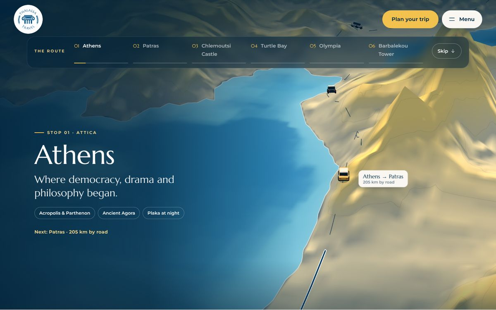
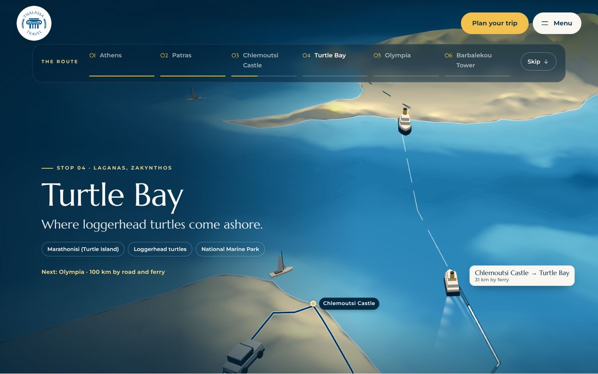

**What you see.** Moving forward from one stop to the next turns into a short drive:
1. The camera swings down behind the 3D car (from V1).
2. It follows the road at low altitude while traffic passes.
3. It boards the ferry view across to Zakynthos.
4. It rises back to the destination's usual framing, where the polaroids appear.

**How it works** (changes to `GreeceMap.ts`)
- **When a ride happens.** Only when stepping forward to the adjacent stop from a settled state. Jumps from the route bar, stepping backwards, the intro and the overview all keep the normal flight. Steps taken mid-flight skip the ride, so a fast scroller is never trapped in long animations.
- **One timeline.** A single linear timeline `r` drives both the camera and the drive. The vehicle's progress is `smoothstep(0.05, 0.93, r)` along the leg. Ride length grows with distance, clamped to 3.2–6.8 s (Athens → Patras ≈ 6.3 s).
- **Chase pose.** 30 km behind the vehicle, 61° pitch. The yaw points from a point 10 km ahead to a point 6 km behind on the smoothed path, which absorbs hairpins without any time-based filtering. The pose blends in during the first 22% of the ride and out over the last 20%, reusing the same `flyTo` easing as the normal flights.
- **Interrupting.** Another step mid-ride starts a normal flight from the current pose, and the route keeps drawing from wherever the car was.
- **Hero size.** The hero vehicle has a minimum world size so it stays larger than the passing traffic.

**Trade-offs.** Transitions are longer, by design. At close range the 0.48 km heightmap looks soft. Low, fast camera motion may bother some users; reduced motion still gets instant cuts.

---

## Version 4: a day passes (`feature/map-v4-daylight`)

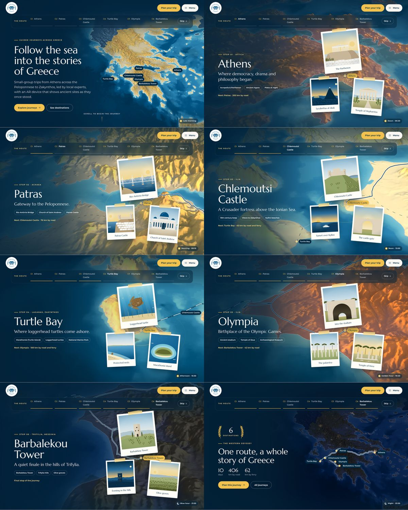
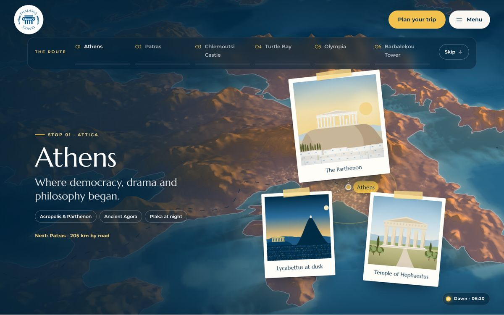
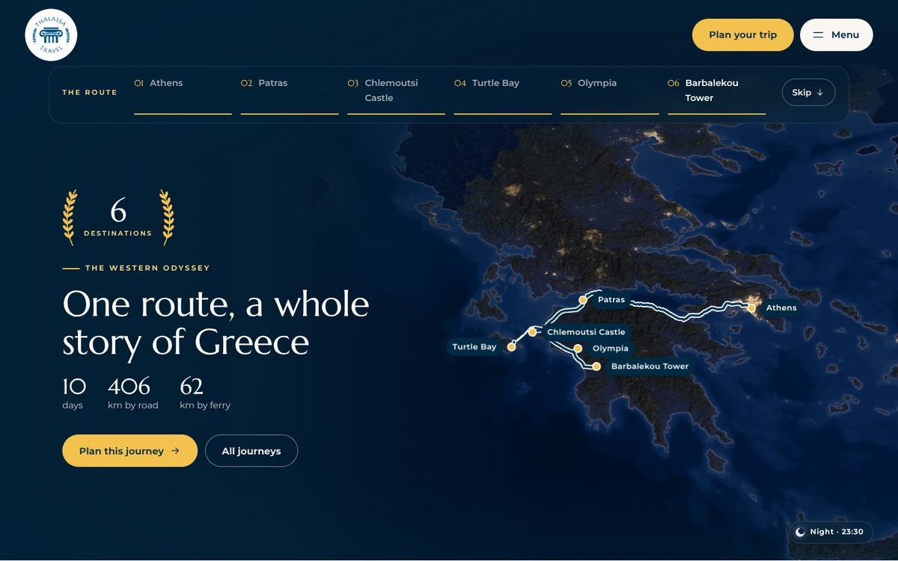

**What you see.** Each step has its own light, and a small chip in the corner names it:

| Step | Mood | Sun / moon | Notes |
| --- | --- | --- | --- |
| Intro | Late morning | WSW, 35° | Identical to the current look |
| Athens | Dawn · 06:20 | E, 7° | Pink-orange light, violet fog, city lights fading |
| Patras | Morning · 09:10 | ESE, 26° | |
| Chlemoutsi | Noon · 13:00 | S, 62° | Short shadows, most cloud |
| Turtle Bay | Afternoon · 16:30 | WSW, 28° | Strongest sea glint |
| Olympia | Golden hour · 19:40 | W, 6° | Deep orange, long shadows |
| Barbalekou | Blue hour · 21:05 | Moon, ESE 30° | Lights come on |
| Overview | Night · 23:30 | Moon, SSE 42° | City lights across Greece |

**How it works** (`terrainMaterial.ts`, `GreeceMap.ts`)
- **Interpolation.** Each mood sets the light direction, sun colour, shadow colour, fog/sky colour, night amount, glint and cloud cover. All of these are interpolated with the camera flight, so the light changes as you travel. The renderer's clear colour follows the fog colour.
- **Cast terrain shadows.** Each fragment ray-marches 22 steps (growing ×1.22 from 0.7 km) toward the sun through the heightmap, with a soft-shadow penumbra term. Shadows also fall on the sea below cliffs.
- **Sea glint.** A specular highlight on animated value-noise wave normals, plus a broad sheen, tinted by the sun colour.
- **Cloud shadows.** Four-octave fBm noise drifting across the map darkens land and sea by up to 30%.
- **Night.** Land and sea darken toward blue. City lights come from the WorldCover built-up channel (the same `landcover.webp` as V2): a base glow, a twinkling dot pattern, and a wide halo from a blurred mip level, so cities still read at overview scale.

**Trade-offs.**
- The fragment shader does about 25 extra texture reads per pixel. The existing automatic resolution drop helps on weak GPUs; the shadow loop is the first thing to cut (fewer steps, or skip it on phones).
- The mood colours temporarily depart from the brand blue. The left scrim keeps the text readable in every mood.

---

## Combining them

Recommendations:

1. **V1 + V4.** Vehicles at golden hour and ferries under moonlight. Both mainly touch `GreeceMap.ts`'s render loop and should merge cleanly. V4's lighting can drive the vehicle lights (`HemisphereLight` and `DirectionalLight` colours from the current mood).
2. **V2's land-cover tint alone.** It costs one texture and a few shader lines, and makes the map clearly richer at every zoom. Add the instanced forests and towns on desktop only.
3. **V3** is a strong storytelling option but changes the pacing most. Consider making it opt-in, for example with a "Ride along" toggle.
4. **Quick vs zoom.** All versions are built on the quick-move branch. The zoom variant differs only in the stop-to-stop camera path (`camera.ts`/`flightDuration`), so each version ports over by cherry-picking.

## How these were tested

- Type-check (`astro check`) and production build pass on every branch.
- Frames were captured in headless Chromium with SwiftShader (software WebGL). A small virtual clock is injected into the page: `performance.now` and `requestAnimationFrame` are replaced, and time is advanced 40 ms per frame (Motion caps each frame's delta at 40 ms), so mid-flight frames can be captured deterministically.
- The screenshots above are from those captures. In real time, software WebGL renders only about one frame per second with the V2 detail layer, so frame-based effects (terrain rise, reveal wave) take longer there than on a real GPU.
- Not tested:
  - real GPU frame rates (especially V2's instances and V4's shadow loop on phones)
  - Safari
  - trackpad gestures
